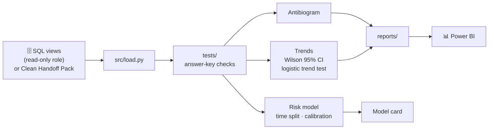
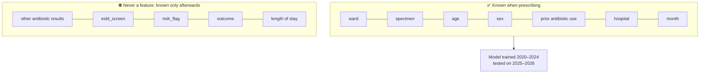

<div align="center">

# 🐍 Kaduna AMR Watch — Analysis

**Every number rebuildable with one command. Every trend with its uncertainty. Every model with its limits.**


</div>

> [!IMPORTANT]
> **SYNTHETIC PRACTICE DATA. RESEARCH ONLY.** Nothing in this repository is a clinical finding or a prescribing tool.

## Why this exists

If a funder asks *"how did you get 61.7%?"*, we must be able to show every step and rerun it in front of them. This repository:

1. **Reproduces** the antibiogram independently of Excel and SQL
2. **Separates real change from noise**, using confidence intervals and trend tests
3. **Estimates resistance risk** before culture results arrive, and tests honestly whether that estimate is safe

## Pipeline



## Model safety



## The answer key

`tests/` must check every row of sheet `11_ANSWER_KEY` in the [Clean Handoff Pack](https://github.com/AMR-Playbook/.github/releases/tag/excel-handoff-v2). The headline check is *E. coli* + ceftriaxone in 2024: **201 resistant of 326 tested (61.66%)**.

## Layout

```
data/raw/      downloaded source data (git-ignored, never edited)
data/clean/    derived tables (git-ignored)
src/           pipeline code: load, antibiogram, trends, model, run_all
tests/         answer-key and integrity tests
notebooks/     exploration only, numbered and runnable top to bottom
reports/       generated tables, figures, methods note, model card
```

## Getting started

```bash
python -m venv .venv && source .venv/bin/activate
pip install -r requirements.txt
```

Then pick an [open issue](../../issues) and read [CONTRIBUTING](https://github.com/AMR-Playbook/.github/blob/main/CONTRIBUTING.md).
