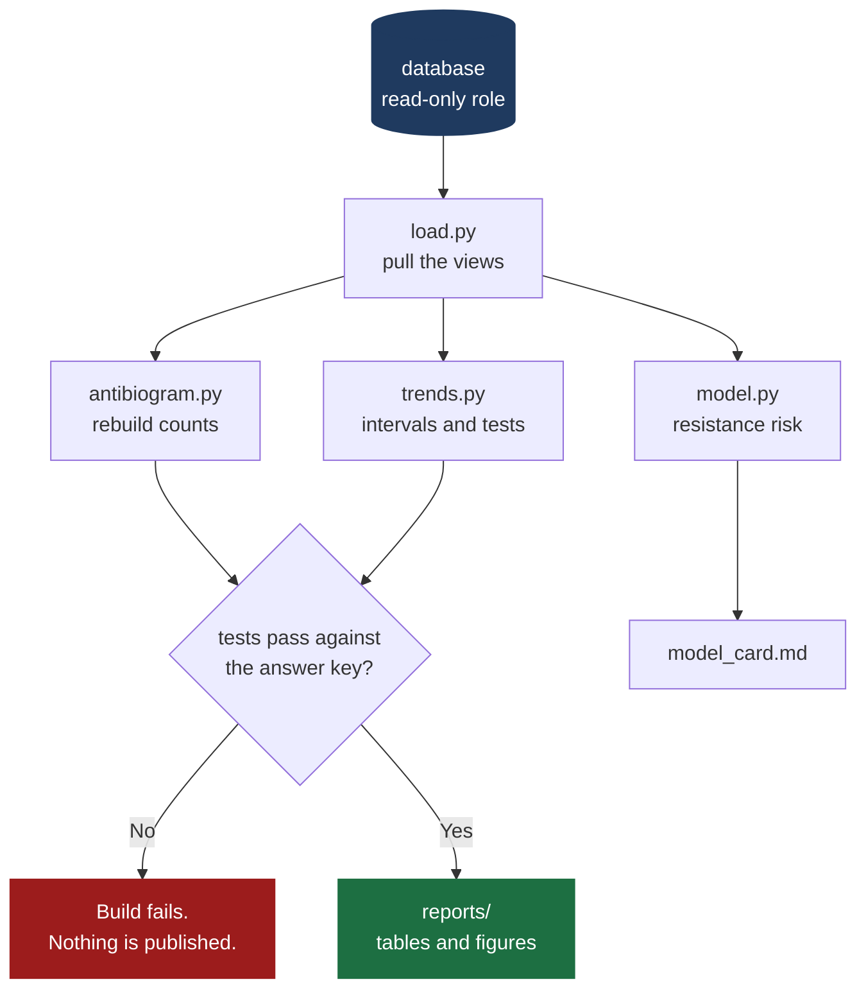

# kaduna-amr-python · pipeline

Reproducible analysis for Kaduna AMR Watch. Rebuilds every published number from source with one command, tests whether changes over time are real, and estimates resistance risk before a laboratory result is available.

> **The data here is synthetic.** It describes invented patients in four fictional hospitals. Any model trained on it is a practice artefact, not a clinical tool.

---

## Why this repository exists

If a funder or a clinician asks "how did you get 61.7%?", we must be able to show every step and rerun it in front of them. Analysis that cannot be rebuilt is opinion.



---

## Repository layout

```
src/
  load.py          Pull data from the database views
  antibiogram.py   Rebuild the antibiogram in pandas
  trends.py        Confidence intervals and trend tests
  model.py         Resistance risk model
  run_all.py       One command, end to end
tests/             Every reference number from the answer key
notebooks/         Exploration only. Nothing here is a deliverable.
reports/           Generated output. Not edited by hand.
requirements.txt   Pinned versions
```

---

## Running it

```bash
python -m venv .venv && source .venv/bin/activate
pip install -r requirements.txt
python src/run_all.py
```

If that does not work on a clean machine for someone who did not write it, this repository has not met its goal.

---

## Columns that must never become model features

These are known only **after** the laboratory result or **after** treatment. A model that uses them will look accurate and be useless, or worse, confidently wrong at the bedside.

| Column | Why it leaks |
|---|---|
| `empiric_active` | Derived from the susceptibility result itself |
| `esbl_screen`, `carbapenemase_screen` | Laboratory findings from the same test |
| `mdr_flag`, `n_classes_nonsusceptible` | Computed from the full susceptibility panel |
| `outcome`, `length_of_stay_days` | Known only after the patient is treated |

Split by time (train on 2020–2024, test on 2025–2026). A random split leaks the future into the past.

---

## Statistical standards

1. Every reported percentage carries its count and a 95% confidence interval.
2. "Rising" and "falling" are claims that require a test, stated in plain English.
3. Count your comparisons. Six organism and antibiotic pairs across seven years is 42 tests, and at the 5% level roughly two will look significant by chance alone.
4. Hospitals differ in case mix. One has an intensive care unit; others do not. Adjust for ward and specimen before comparing them.
5. The data only includes patients sick enough, and able to pay, for a culture. Say so wherever it matters.
